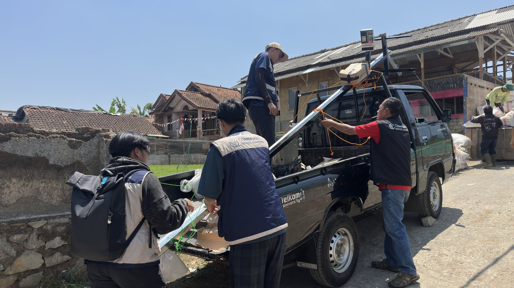
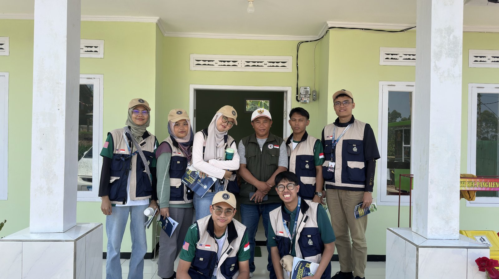
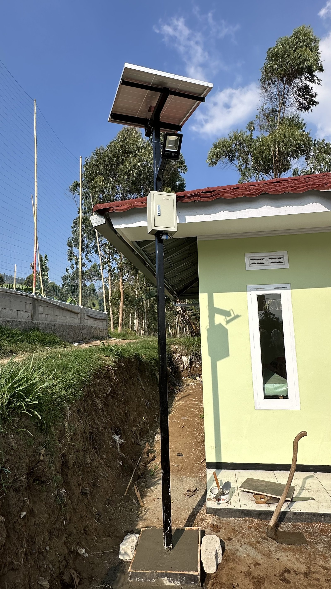
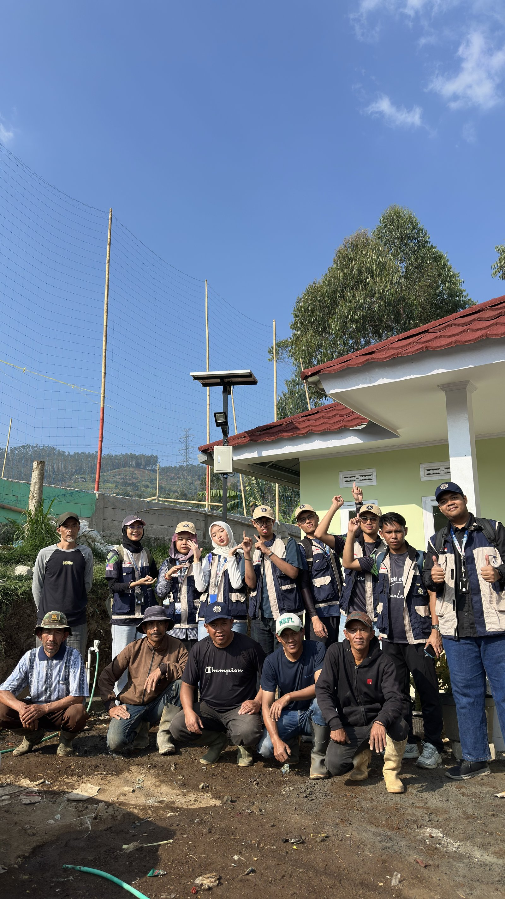

# 💡 SMART STREET LAMP - Automasi Tombol Nyala Bertenaga Surya
### Automation Switch With Solar Powered Energy | Group 2 HARUDA

> Lampu jalan pintar yang memanfaatkan energi matahari sebagai sumber daya utama. Lampu ini menggunakan sistem otomatis berbasis sensor cahaya (Photocell) untuk meningkatkan keamanan dan aktivitas warga di malam hari.

[Poster](docs/Poster_Group_2.png)

---

### 📍 Informasi Pengabdian

- **Program:** Community Service Learning (CSL) 2026 - Telkom University x Universiti Teknologi Petronas
- **Lokasi:** Desa Margamukti, Kecamatan Pangalengan, Kabupaten Bandung, Provinsi Jawa Barat
- **Periode Pelaksanaan:** 26 Agustus - 2 September 2026
- **Sistem:** 12V DC Solar PJU Otomatis

### 👥 Our Team - Kelompok 2 HARUDA

| No | Nama Lengkap | Role |
|----|---------------|------|
| 1 | **Jabriel Bamasena Javier Rahardjanto** | Team Leader |
| 2 | **Mirza Ahmad Alvarino** | Accountant / RAB & Hardware |
| 3 | **Elga Dina Pertiwi** | Designer - Guidebook & Manual |
| 4 | **Nurul Dayani Binti Ruding** | Journalist - Dokumentasi & Laporan |
| 5 | **Nasywa Zakiyah Alfi** | Designer - Poster & Branding |
| 6 | **Ahmad Adib Syahmi Bin Ahmad Badrulhisham** | Communicator - Koordinasi Lapangan |
| 7 | **Adam Haziq bin Jabar** | Communicator - Instalasi & Testing |

**Dosen Pembimbing:** Malldi Saesar Ariffudin, S.T., M.T.

---

### ✨ Keunggulan Sistem

- **SISTEM ON/OFF OTOMATIS** - Photocell Sensor DC 12V 10A, otomatis nyala saat gelap
- **BERTENAGA SURYA MATAHARI** - Solar Panel 100Wp sebagai sumber energi utama
- **HEMAT ENERGI** - Lampu LED DC 12V 20W IP65 + Baterai LiFePO4 20Ah
- **DAPAT DIGUNAKAN DI PUBLIK** - Cocok untuk jalan desa, tahan cuaca

### 🔧 Spesifikasi Hardware (Sesuai RAB Real Group 2)

| Komponen | Spesifikasi | Harga Real |
|----------|-------------|------------|
| Solar Panel | 100Wp 12V - Toko Kim Hien | Rp 730.000 |
| Baterai | LiFePO4 12.8V 20Ah + BMS - AA Baterai Project | Rp 509.663 |
| Solar Charge Controller | PWM 10A 12V/24V - CNC Store Bandung | Rp 61.600 |
| Lampu LED | DC 12V 20W IP65 - Teguh Jaya | Rp 125.000 |
| Photocell Sensor | DC 12V 10A - CNC Store Bandung | Rp 24.600 |
| Panel Box | Box Panel + Shipping - Primier Electrindo | Rp 93.200 |
| Tiang + Aksesoris | Hollow + Cakar Ring + Baut + Ferrules + Kabel + MC4 | Rp 310.000 |

**TOTAL OUTCOME: Rp 1.854.063**
**INCOME / Dana Program: Rp 2.000.000**
**BALANCE: Rp 145.937**

> Rincian lengkap dengan link nota Google Drive ada di `docs/Group_Purchasing_Material_Report_-_GROUP_2.pdf`

### ⚡ Wiring Diagram - Sistem 12V DC

[Wiring Diagram](docs/wiring.jpg)

```
Alur: Solar Panel 100Wp -> SCC PWM 10A -> Baterai LiFePO4 20Ah -> Fuse 10A -> Photocell 12V -> LED 20W

Detail Photocell:
IN+ (Merah) & IN- (Hitam) dari Baterai via Fuse
OUT+ (Merah) & OUT- (Hitam) ke Lampu LED
```

**Alur Kerja:**
- **Siang:** Panel surya mengisi baterai via SCC
- **Malam:** Photocell deteksi gelap -> Relay ON -> Lampu nyala otomatis
- **Pagi:** Photocell deteksi terang -> Lampu mati, kembali charging

Panduan instalasi lengkap ada di `docs/GuideBook_Group_2.pdf`

### 📸 Dokumentasi Lapangan - Desa Margamukti, Pangalengan






### 📄 Lisensi & Penggunaan
© 2026 Group 2 HARUDA - CSL Telkom University x UTP
Boleh digunakan untuk edukasi dan pengembangan desa selanjutnya.

---
**Contact:** Mirza Ahmad Alvarino - Team Accountant - GitHub: @oniravlaa
